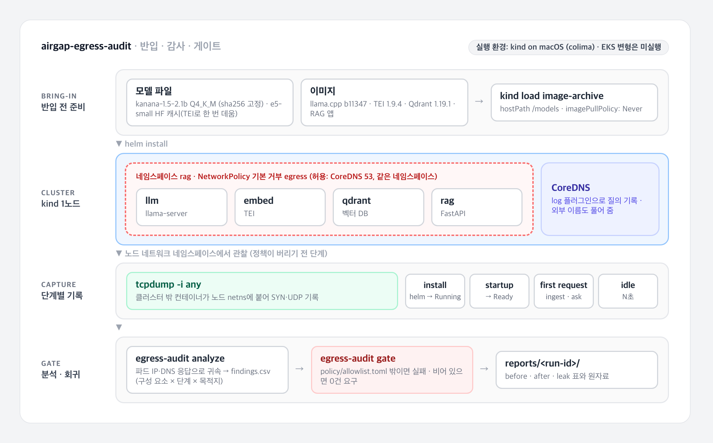

# 폐쇄망 반입 후 외부 호출 감사

[](https://github.com/parksungyun0411/airgap-egress-audit/actions/workflows/ci.yml)   [](LICENSE)

한국어 소형 LLM과 RAG 스택을 egress가 막힌 쿠버네티스 네임스페이스에 설치하고, 설치·기동·첫 요청·유휴 네 단계에서 밖으로 나가려는 시도를 모두 기록합니다. 기록한 시도를 설정으로 막은 뒤, "외부 호출 0건"을 회귀 게이트로 고정하는 프로젝트입니다.

폐쇄망 반입은 보통 "필요한 이미지와 모델 파일을 모두 들고 들어가면 끝난다"고 가정합니다. 실제로는 파일이 다 있어도 구성 요소가 기동하면서 허브에 메타데이터를 묻거나 사용 통계를 보내려 하고, 막힌 요청마다 타임아웃을 기다리느라 기동이 늦어집니다. 이 프로젝트는 그런 시도를 문서가 아니라 패킷으로 확인합니다. 이미지와 모델을 클러스터에 미리 넣어 두었으므로, 그 상태에서도 밖으로 나가려는 시도가 있으면 그것이 곧 발견 사항입니다.

선행 작업과의 관계는 다음과 같습니다.

| 선행 작업 | 다루는 것 | 이 프로젝트와의 차이 |
|---|---|---|
| [Particula, vLLM Air Gapped Deployment](https://particula.tech/blog/vllm-air-gapped-offline-deployment) (2026-08) | vLLM의 egress 경로 10개와 이를 닫는 설정을 소스·문서 기준으로 정리하고, `docker run --network none` 시험을 제안 | 경로를 문서로 열거했고 캡처한 측정값은 없습니다. 이 프로젝트는 다른 스택(llama.cpp·TEI·Qdrant)에서 실제 시도를 패킷으로 기록합니다 |
| [thaocao1/airgap-llm-framework](https://github.com/thaocao1/airgap-llm-framework) | Helm·Ansible로 폐쇄망 LLM 스택 배포, egress 기본 거부 NetworkPolicy | 배포 틀이 중심이며 egress 시도를 관찰·기록하는 부분은 없습니다 |
| [mkamranr/offlineai](https://github.com/mkamranr/offlineai) | 모델·이미지·휠을 하나의 번들로 묶어 반입 | 번들러입니다. 이 프로젝트는 번들러를 다시 만들지 않고, 반입이 끝난 뒤의 검증만 맡습니다 |

> 결과는 모두 **kind on macOS (colima)** 에서 낸 것이며 EKS가 아닙니다. EKS 변형은 작성만 했고 실행하지 않았습니다(측정 전).

## 구현 범위

- 감사 대상 스택: llama.cpp `llama-server`(kanana-1.5-2.1b-instruct Q4_K_M), Text Embeddings Inference(multilingual-e5-small), Qdrant, FastAPI RAG 앱을 한 Helm 차트로 설치
- 반입 상태 재현: 이미지는 `kind load image-archive`로 노드에 넣고 `imagePullPolicy: Never`로 설치, 모델 파일은 hostPath로 연결
- 네임스페이스 egress 기본 거부 NetworkPolicy, 예외는 CoreDNS(53)와 같은 네임스페이스뿐
- 캡처: 클러스터 밖 컨테이너가 kind 노드의 네트워크 네임스페이스에 붙어 `tcpdump -i any`로 TCP SYN과 UDP를 기록, CoreDNS `log` 플러그인으로 질의 기록, 5초마다 파드 IP 기록
- 단계 구분: 설치(helm → 컨테이너 Running), 기동(→ Ready), 첫 요청(문서 적재·질의), 유휴(기본 600초)
- 분석기 `egress-audit analyze`: 파드 IP와 DNS 응답으로 시도를 구성 요소·단계·목적지에 귀속하고, 클러스터 밖으로 실제로 나갔는지(TCP·UDP는 노드 eth0의 NAT 사본, DNS는 CoreDNS가 상위 리졸버로 넘긴 질의)까지 구분
- 회귀 게이트 `egress-audit gate`: `policy/allowlist.toml` 밖의 외부 호출이 있으면 실패, 허용 목록이 비어 있으면 0건 요구
- 정책 자체 점검: 실행마다 기본 거부 네임스페이스에서 기동 직후(0초)와 15초 뒤의 연결을 시도해 정책 적용 여부를 기록하고, 별도 시험(`scripts/policy_timing.sh`)으로 정책 반영 지연과 새 파드 틈을 나눠 확인
- 완화(after)와 일부러 넣은 누출(leak) 설정, before·after·leak 비교 리포트 생성
- CI: push마다 lint·pytest(합성 누출 픽스처 포함)·커밋된 최신 감사 결과에 대한 게이트·Helm 검증, kind 감사 전체는 수동 실행 워크플로
- EKS 변형(미실행): eksctl 설정(VPC CNI 정책 판정 로그 켬), 모델 내장 이미지, OIDC 배포 워크플로, 정리 스크립트

## 아키텍처



다이어그램 원본은 [docs/diagrams/architecture.html](docs/diagrams/architecture.html)입니다.

캡처 방식은 다음 이유로 골랐습니다.

| 후보 | 판단 |
|---|---|
| CNI·정책 엔진 로그 | 기본 설정의 kindnet DaemonSet 로그에는 패킷별 정책 판정이 남지 않았습니다. 버린 패킷과 통과한 패킷을 구분할 기록으로 쓸 수 없었습니다 |
| 파드마다 tcpdump 사이드카 | 감사 대상 매니페스트를 바꿔야 하고, 사이드카 자체가 egress 대상이 됩니다 |
| **노드 netns에서 tcpdump** (채택) | 파드가 보낸 패킷은 파드 쪽 veth에 먼저 잡히므로 정책이 버리기 전의 시도가 남습니다. NAT된 사본이 노드 eth0으로 나갔는지를 보면 실제로 나간 시도도 구분됩니다. 클러스터 객체를 하나도 추가하지 않습니다 |
| CoreDNS `log` 플러그인 | 병행합니다. 질의한 이름이 남아 IP만으로는 알 수 없는 목적지를 이름으로 기록합니다 |

CoreDNS는 외부 이름도 상위 리졸버로 풀어 줍니다. 실제 폐쇄망에는 상위 리졸버가 없지만, 이름이 풀려야 구성 요소가 어느 주소·포트로 연결을 시도하는지까지 관찰할 수 있어 이렇게 두었습니다.

## 기술 스택

| 영역 | 기술 |
|---|---|
| 감사 대상 |     |
| 클러스터 |     |
| 캡처 |   |
| 분석·리포트 |   |
| CI/CD |  |
| EKS 변형(미실행) |   |
| 코드 품질 |     |

모델과 라이선스:

| 용도 | 모델 | 라이선스 |
|---|---|---|
| LLM | [kakaocorp/kanana-1.5-2.1b-instruct-2505](https://huggingface.co/kakaocorp/kanana-1.5-2.1b-instruct-2505)의 GGUF 변환본 [DevQuasar/…-GGUF](https://huggingface.co/DevQuasar/kakaocorp.kanana-1.5-2.1b-instruct-2505-GGUF) Q4_K_M, 커밋 `4d3b620`, sha256 고정 | 원본 모델 카드 기준 Apache-2.0. 변환본 저장소 카드에는 라이선스 표기가 없습니다 |
| 임베딩 | [intfloat/multilingual-e5-small](https://huggingface.co/intfloat/multilingual-e5-small), 커밋 `614241f` | MIT |

## 실행 방법

### 로컬 검증

필요한 도구는 uv, helm, kubeconform입니다.

```bash
uv sync
uv run pytest -q
helm lint charts/rag-stack --strict
helm template rag charts/rag-stack | kubeconform -strict -summary
```

`uv sync`가 개발 도구(pytest, ruff)를 dev 의존성 그룹으로 함께 설치합니다. `uv run --extra dev pytest -q`처럼 extra로 불러도 됩니다.

테스트는 `tests/fixtures/`의 합성 캡처로 분석기와 게이트를 검증합니다. 깨끗한 캡처에 누출 패킷(`leak-lines.txt`, 문서용 예약 도메인·주소)을 일부러 덧붙이면 게이트가 실패하는지도 확인합니다. 합성 데이터는 측정 결과가 아닙니다.

### kind 감사

필요한 것은 colima와 docker CLI(또는 다른 docker 엔진), kind, kubectl, helm, uv입니다. 이 저장소의 결과는 colima VM(4 vCPU, 8GiB)에서 냈습니다.

```bash
brew install colima docker kind kubectl helm uv
colima start --cpu 4 --memory 8 --disk 40 --vm-type vz

# 1. 반입 전 준비(인터넷이 되는 쪽): 모델 파일을 받고, TEI를 한 번 띄워 HF 캐시를 데운다
scripts/fetch_models.sh
docker build -t airgap-rag-app:0.1.0 app

# 2. before · after · leak 감사 (각각 kind 클러스터를 새로 만들고 끝나면 지운다)
RUN_ID=kind-$(date -u +%Y%m%d) IDLE_SECONDS=600 scripts/run_all.sh before after leak

# 3. 게이트
uv run egress-audit gate --findings results/<run-id>/after/findings.csv
```

colima VM의 커널에는 `nfnetlink_queue` 모듈이 기본으로 올라와 있지 않습니다. kindnet의 정책 엔진이 이 모듈을 쓰기 때문에, `scripts/audit.sh`가 모듈을 올리고 kindnet을 다시 띄운 뒤 정책 자체 점검을 기록합니다.

설치한 도구 정리:

```bash
kind delete cluster --name airgap   # 감사 스크립트가 끝날 때 이미 지운다
colima delete                       # VM과 이미지 삭제
brew uninstall colima docker kind kubernetes-cli lima
```

### GitHub Actions

| 워크플로 | 시점 | 내용 |
|---|---|---|
| `ci.yml` | push·PR | ruff, pytest(누출 픽스처 포함), 커밋된 최신 `reports/kind-*/after`에 대한 게이트, Helm lint·kubeconform, hadolint, shellcheck, actionlint |
| `audit.yml` | 수동 | ubuntu 러너의 kind에서 before·after·leak 감사, after는 통과하고 leak은 실패해야 성공. 한 번 실행에 약 2시간이 걸려 push마다 돌리지 않습니다 |
| `deploy-eks.yml` | 수동 | EKS 변형 배포(작성만 했고 실행하지 않았습니다) |

## 평가

모든 값의 출처는 [reports/kind-20261003/REPORT.md](reports/kind-20261003/REPORT.md)이며, 실행 환경은 kind v0.33.0(Kubernetes v1.37.0, kindnetd v20260820) on macOS·colima 0.10.3, 유휴 관찰 600초입니다.

구성 요소별 외부 호출 시도(`before` → `after`):

| 구성 요소 | before에서 관찰한 시도 | 단계 | 완화 | after |
|---|---|---|---|---|
| embed (TEI 1.9.4) | `huggingface.co` DNS 질의 32회(그중 6회는 CoreDNS가 상위 리졸버로 넘김), TCP 443 SYN 109회(CloudFront IP 4개). 첫 SYN 1회는 클러스터 밖으로 나갔습니다(허브가 404로 응답한 로그가 남음) | 설치·기동 | 허브 모델 ID 대신 로컬 스냅숏 경로를 `--model-id`로 지정 | 0 |
| qdrant (1.19.1) | `telemetry.qdrant.io` DNS 질의 8회(그중 2회는 상위 리졸버로 넘어감), TCP 443 SYN 1회. 이 SYN은 클러스터 밖으로 나갔습니다 | 설치 | `QDRANT__TELEMETRY_DISABLED=true` | 0 |
| llm (llama.cpp b11347) | 관찰되지 않음 | — | 없음 | 0 |
| rag (FastAPI 앱) | 관찰되지 않음 | — | 없음 | 0 |
| node (containerd·kubelet) | 관찰되지 않음 | — | — | 0 |

| 지표 | before | after |
|---|---:|---:|
| 게이트 | FAIL (6행) | PASS (0건) |
| Running → 전체 Ready | 364초 | 5초 |

before에서 TEI는 허브 요청이 막힐 때마다 약 120초씩 기다렸습니다. `before/log-embed.txt` 기준으로 모델 백엔드 시작(07:24:46) 뒤 07:26:47, 07:28:48, 07:30:49에 각각 다음 단계로 넘어갔고 07:30:50에 Ready가 되었습니다. 두 번째와 세 번째 대기는 허브 저장소에도 없는 `onnx/model.onnx_data`, `model.onnx_data`를 받으려던 것이고, 첫 번째 대기의 대상은 로그에 나오지 않습니다. Running에서 Ready까지 걸린 364초는 대부분 이 대기입니다. 허브에 없는 `config_sentence_transformers.json` 요청은 기동 직후라 실제로 나갔고 404를 받았습니다.

정책 자체 점검(`*/policy-check.txt`)은 세 번의 실행 모두 같은 결과였습니다. 기본 거부 네임스페이스에서 파드가 뜨자마자 시도한 연결은 통과했고, 15초 뒤의 연결은 막혔습니다. 다만 이 점검은 정책을 만들자마자 파드를 띄우고, 차트도 정책과 파드를 한 릴리스로 함께 설치하므로, "정책 자체가 늦게 적용된다"와 "새 파드가 처음 잠깐 정책 밖에 있다"를 구분하지 못합니다.

그래서 두 경우를 나눈 시험을 따로 돌렸습니다([reports/policy-timing-20261003/REPORT.md](reports/policy-timing-20261003/REPORT.md), 새 kind 클러스터 2개).

| 시험 | 관찰 |
|---|---|
| 이미 떠 있는 파드에 정책을 건 직후 | 2/2 막힘(정책 적용 후 첫 시도부터) |
| 정책이 막는 것을 확인하고 10초 뒤 만든 새 파드, 프로세스 시작 직후 | 16/16 연결됨 |
| 같은 새 파드, 약 0.5초 뒤 | 7/16 연결됨 |
| 같은 새 파드, 약 1초 이후 | 0/64 연결됨 |

이 환경에서는 정책 반영 지연은 시험 해상도 안에서 보이지 않았고, 정책이 이미 적용된 네임스페이스에서도 새로 뜬 파드가 첫 1초 안팎 동안 밖으로 나갈 수 있었습니다. before에서 클러스터 밖으로 나간 두 SYN(TEI 1.0초, Qdrant 0.6초)도 이 구간에 있고, leak의 1.5초 SYN은 막혔습니다. 원인은 확인하지 않았습니다. 이 틈 때문에 차단은 구성 요소 설정(after)으로 하고, 정책은 관찰 대상을 좁히는 장치로 씁니다.

누출 주입(`leak`): after 설정 위에 RAG 앱이 기동할 때 `https://example.com/`을 한 번 호출하도록 환경변수만 더했습니다. 감사는 `example.com` DNS 질의 8회(그중 2회는 상위 리졸버로 넘어감)와 TCP 443 SYN 10회(IP 2개, 모두 정책에 막힘)를 기록했고, 게이트는 3행으로 실패했습니다. 같은 동작을 합성 픽스처로 재현한 테스트가 CI에서 매번 돕니다.

## 프로젝트 구조

```text
airgap-egress-audit/
├── app/                    감사 대상 FastAPI RAG 앱과 Dockerfile
├── charts/rag-stack/       Helm 차트, values(before)·values-after·values-leak·values-eks
├── kind/                   kind 클러스터 설정
├── scripts/                반입 준비, 감사 실행, 정책 자체 점검·적용 시점 시험, 전체 실행
├── src/egressaudit/        캡처 파서, 분석기, 게이트, 리포트 생성기
├── policy/allowlist.toml   허용하는 외부 호출(비어 있음 = 0건 요구)
├── tests/                  단위 테스트와 합성 픽스처(누출 주입 포함)
├── reports/                감사 결과와 원자료, 정책 적용 시점 시험
├── images/                 EKS 변형용 모델 내장 이미지
├── infra/                  EKS 변형용 eksctl·IAM·정리 스크립트·비용 메모
├── docs/diagrams/          다이어그램(HTML 원본·PNG)
└── .github/workflows/      ci.yml, audit.yml, deploy-eks.yml
```

## 구현하면서 신경 쓴 점

- 관찰은 정책 엔진과 분리했습니다. 정책 엔진이 판정 로그를 주지 않아도, 노드 netns의 패킷 사본만으로 시도와 실제 유출을 나눠 셀 수 있습니다. 이 덕분에 새 파드의 첫 1초 안팎에 생기는 유출을 찾았고, 처음의 해석(정책 반영 지연)이 다른 원인과 섞여 있다는 리뷰를 받아 시험을 다시 설계했습니다.
- DNS 시도 수는 한 외부 이름의 모든 형태(그대로, 클러스터 검색 도메인 세 가지, 노드 검색 도메인)를 같은 규칙으로 셉니다. 처음 구현은 점이 하나인 이름(`huggingface.co.svc.cluster.local`)을 내부 이름으로 잘못 분류해 형태마다 세는 방식이 달랐고, 원자료 이름 그대로 테스트를 추가해 고쳤습니다.
- CI는 커밋된 원자료(`capture.txt` 등)로 분석을 다시 돌려 `findings.csv`와 비교합니다. 게이트가 오래된 결과 파일이 아니라 지금의 분석기를 시험하게 하려는 것입니다.
- kind의 NetworkPolicy 지원은 kind v0.24.0 릴리스 노트("Out-of-the-box support for network policy via sigs.k8s.io/kube-network-policies")를 근거로 삼았지만, 문서만 믿지 않고 실행마다 직접 점검했습니다. 첫 시도에서는 colima 커널에 `nfnetlink_queue`가 없어 정책이 조용히 무시되었고, 그 상황을 감사 스크립트가 감지해 중단하도록 했습니다.
- before 설정은 각 구성 요소 문서의 기본 실행 예시를 따랐습니다. TEI는 허브 모델 ID와 `/data` 캐시 볼륨, Qdrant는 기본 설정입니다. 반입 파일이 부족해서 생긴 실패와 구성 요소의 동작을 구분하려고, HF 캐시는 TEI를 한 번 온라인으로 띄워 TEI가 실제로 읽는 파일로 채운 뒤 들고 들어갔습니다.
- 완화는 원인을 확인한 뒤 골랐습니다. TEI는 `router/src/lib.rs`(v1.9.4)에서 `--model-id`가 존재하는 디렉터리이면 허브 API를 만들지 않는 것을 소스로 확인했습니다. Qdrant는 공식 문서의 사용 통계 비활성화 방법을 썼습니다.
- 기동 프로브가 막힌 요청 대기 때문에 파드를 재시작하면 같은 시도가 반복되어 기록이 흐려집니다. before에서 TEI의 기동 한도를 20분으로 넉넉하게 두어 한 번의 기동 과정을 끝까지 기록했습니다.
- 게이트는 허용 목록 방식입니다. 꼭 필요한 외부 호출이 생기면 이유와 함께 목록에 적어야 하므로, 예외가 코드 리뷰에 드러납니다.

## 한계

- kind는 실제 폐쇄망이 아닙니다. 노드는 인터넷에 연결된 macOS의 colima VM 안에 있고, CoreDNS는 외부 이름을 풀어 줍니다. 상위 리졸버가 없는 현장에서는 구성 요소가 DNS 실패 후 다르게 동작할 수 있습니다.
- 윈도 PC로 반입하는 경우는 쿠버네티스와 다른 환경입니다. 이 결과는 그 경우에 그대로 옮길 수 없습니다.
- 유휴 600초 동안 관찰되지 않았다는 것은 호출이 없다는 증명이 아닙니다. 하루 단위 주기 작업, 특정 요청이나 오류에서만 생기는 호출, 버전 확인 같은 드문 동작은 놓칠 수 있습니다.
- 시험한 구성 요소는 llama.cpp `llama-server` b11347, Text Embeddings Inference 1.9.4(arm64 CPU 이미지), Qdrant 1.19.1, 직접 만든 FastAPI 앱(qdrant-client 1.19.1, httpx 0.28.1)뿐입니다. 다른 버전이나 vLLM·Ollama 같은 다른 런타임에는 결과를 일반화할 수 없습니다.
- 캡처는 IPv4의 TCP SYN과 UDP만 봅니다. IPv6, ICMP, 이미 맺어진 연결 위로 보내는 데이터는 기록하지 않습니다.
- kind 감사는 한 번씩만 실행했습니다(before·after·leak 각 1회). 새 파드 틈은 클러스터 2개, 파드 16개에서 재현했지만 원인은 확인하지 않았고, 그 길이는 0.5초 간격 시도로만 쟀습니다.
- DNS는 막지 않은 유출 경로입니다. NetworkPolicy는 CoreDNS까지 허용하고 CoreDNS는 외부 이름을 상위 리졸버로 넘기므로, after에서도 파드가 외부 이름을 물으면 그 이름은 클러스터 밖으로 나갑니다(after에서는 그런 질의가 관찰되지 않았습니다). 질의 이름에 데이터를 실어 보내는 방식은 이 감사와 정책으로 막을 수 없습니다.
- 이번 실행의 `host-images.txt`(레지스트리 digest)는 감사 직후 같은 로컬 이미지 저장소에서 기록했습니다. 이후 실행부터는 감사 스크립트가 실행 중에 기록합니다.
- EKS 변형(VPC CNI 정책 판정 로그)은 작성만 했고 실행하지 않았습니다. 측정 전입니다.
- `audit.yml`(GitHub ubuntu 러너의 kind 감사)는 2026-10-03에 한 번 끝까지 돌았고(run 37110210642, 약 1시간 53분), after는 게이트를 통과하고 leak은 실패했습니다. 다만 세 실행 모두 `llm`(llama-server) 파드가 25분 안에 Ready가 되지 않았고 로그가 비어 있어 원인을 확인하지 못했습니다. 그래서 러너 결과는 before·after 비교로 쓰지 않으며, 이 문서의 표는 그 결과가 아닙니다. 이후 실행부터는 `pods-describe.txt`를 함께 남깁니다.

## 라이선스

코드는 [MIT](LICENSE) 라이선스를 따릅니다. 모델 파일은 저장소에 포함하지 않으며, 위 표의 각 모델 라이선스를 따릅니다.
