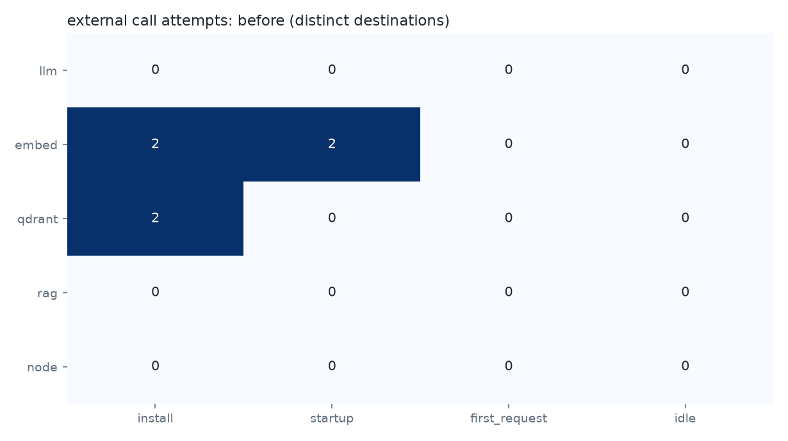
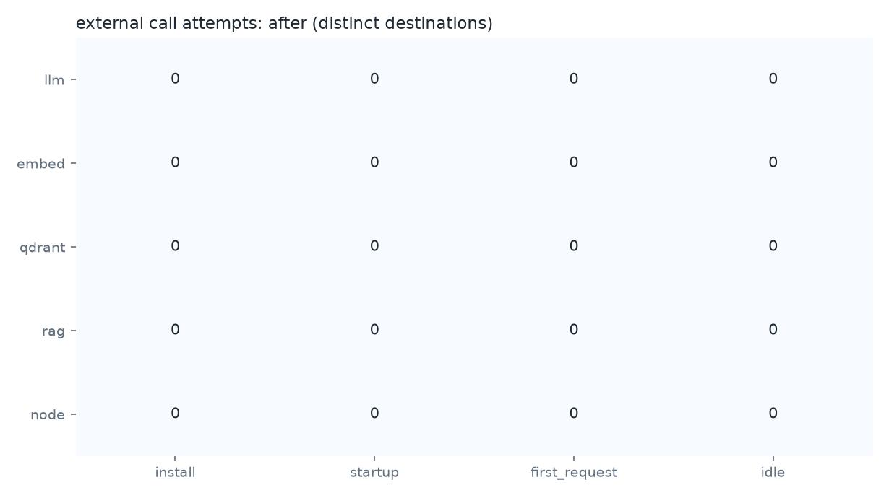
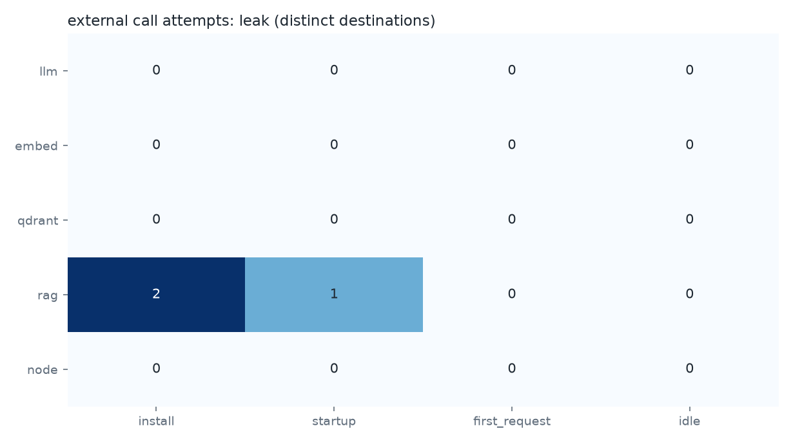

# 외부 호출 감사 결과: kind-20261003 (kind on macOS, colima)

## 실행 환경과 명령

```bash
RUN_ID=kind-20261003 IDLE_SECONDS=600 scripts/run_all.sh before after leak
```

```text
kind: kind v0.33.0 go1.27.0 darwin/arm64
kubernetes: v1.37.0
node image: kindest/node:v1.37.0@sha256:a1ed56cfb0e7b93589bdf97c8cd566405a265939e3620fc4f5de89adff580ae5
kindnetd: docker.io/kindest/kindnetd:v20260820-69b56db7
coredns: registry.k8s.io/coredns/coredns:v1.14.6
docker: 29.5.2 (arm64)
colima: colima version 0.10.3
capture: nicolaka/netshoot@sha256:b09d9b21381f47a79b3cbcb30da25266dc17186ea00ae65e99fdc51396f48e70
host: Darwin arm64
```

감사 대상 이미지와 레지스트리 digest(호스트 docker 기준):

| 이미지 | digest |
|---|---|
| ghcr.io/ggml-org/llama.cpp:server-b11347 | ghcr.io/ggml-org/llama.cpp@sha256:970168341efef973da5666ea5c362fa428ee66ba0dfa621b0f69bf3feb3320f7 |
| ghcr.io/huggingface/text-embeddings-inference:cpu-arm64-1.9.4 | ghcr.io/huggingface/text-embeddings-inference@sha256:798cd7615e060a72ccbdf19aa0ada52289c6a0147490195bafaece6ce04d70f1 |
| qdrant/qdrant:v1.19.1 | qdrant/qdrant@sha256:12364fe851b9f17356fc88189fc06d1b521262e04659ec7345975b00c9246a10 |
| airgap-rag-app:0.1.0 | airgap-rag-app@sha256:e99c3e1c369f25f2d800b5af4de284c0334b9a5d4774954f6902b9ece608d5e7 |

`노드 밖으로 나감`은 같은 패킷의 NAT 사본이 노드 eth0으로 나간 수다. 0이면 정책이 버렸다.
DNS 시도 수는 검색 도메인을 붙인 질의(A·AAAA)를 모두 센 값이다.

## before

원자료: [`before/`](before/) · 설치→Running 2초 · Running→Ready 364초 · 유휴 관찰 600초



구성 요소 × 단계별 서로 다른 외부 목적지 수:

| 구성 요소 | install | startup | first_request | idle |
|---|---|---|---|---|
| llm | 0 | 0 | 0 | 0 |
| embed | 2 | 2 | 0 | 0 |
| qdrant | 2 | 0 | 0 | 0 |
| rag | 0 | 0 | 0 | 0 |
| node | 0 | 0 | 0 | 0 |

시도 목록:

| 구성 요소 | 단계 | 프로토콜 | 목적지 | IP | 포트 | 시도 | 노드 밖으로 나감 | 처음 본 시각(초) |
|---|---|---|---|---|---|---|---|---|
| embed | install | dns | huggingface.co |  | 53 | 6 | 0 | 0.9 |
| embed | install | tcp | huggingface.co | 3.168.178.58 | 443 | 1 | 1 | 1.0 |
| embed | startup | dns | huggingface.co |  | 53 | 18 | 0 | 1.7 |
| embed | startup | tcp | huggingface.co | 3.168.178.31 | 443 | 108 | 0 | 1.7 |
| qdrant | install | dns | telemetry.qdrant.io |  | 53 | 8 | 0 | 0.6 |
| qdrant | install | tcp | telemetry.qdrant.io | 23.23.139.54 | 443 | 1 | 1 | 0.6 |

게이트:

```text
FAIL: 허용 목록 밖의 외부 호출 시도 6건
  embed [install] dns huggingface.co:53 x6
  embed [install] tcp huggingface.co:443 x1
  embed [startup] dns huggingface.co:53 x18
  embed [startup] tcp huggingface.co:443 x108
  qdrant [install] dns telemetry.qdrant.io:53 x8
  qdrant [install] tcp telemetry.qdrant.io:443 x1
```

## after

원자료: [`after/`](after/) · 설치→Running 1초 · Running→Ready 5초 · 유휴 관찰 600초



구성 요소 × 단계별 서로 다른 외부 목적지 수:

| 구성 요소 | install | startup | first_request | idle |
|---|---|---|---|---|
| llm | 0 | 0 | 0 | 0 |
| embed | 0 | 0 | 0 | 0 |
| qdrant | 0 | 0 | 0 | 0 |
| rag | 0 | 0 | 0 | 0 |
| node | 0 | 0 | 0 | 0 |

외부 목적지로 향한 시도가 관찰되지 않았다.

게이트:

```text
PASS: 허용 목록 밖의 외부 호출 시도 0건
```

## leak

원자료: [`leak/`](leak/) · 설치→Running 2초 · Running→Ready 9초 · 유휴 관찰 600초



구성 요소 × 단계별 서로 다른 외부 목적지 수:

| 구성 요소 | install | startup | first_request | idle |
|---|---|---|---|---|
| llm | 0 | 0 | 0 | 0 |
| embed | 0 | 0 | 0 | 0 |
| qdrant | 0 | 0 | 0 | 0 |
| rag | 2 | 1 | 0 | 0 |
| node | 0 | 0 | 0 | 0 |

시도 목록:

| 구성 요소 | 단계 | 프로토콜 | 목적지 | IP | 포트 | 시도 | 노드 밖으로 나감 | 처음 본 시각(초) |
|---|---|---|---|---|---|---|---|---|
| rag | install | dns | example.com |  | 53 | 6 | 0 | 1.5 |
| rag | install | tcp | example.com | 104.20.23.154 | 443 | 1 | 0 | 1.5 |
| rag | startup | tcp | example.com | 172.66.147.243 | 443 | 9 | 0 | 1.7 |

게이트:

```text
FAIL: 허용 목록 밖의 외부 호출 시도 3건
  rag [install] dns example.com:53 x6
  rag [install] tcp example.com:443 x1
  rag [startup] tcp example.com:443 x9
```
